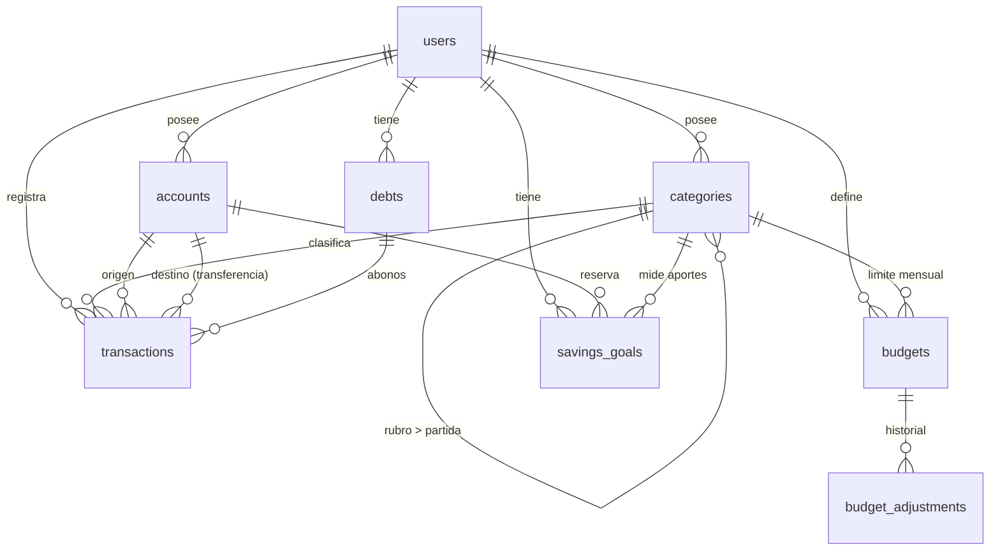

# Finanzas Personales API (Capital Flow)

Backend en **NestJS 10 + TypeORM + PostgreSQL** que da soporte a las 5 pantallas del diseño
(Dashboard, Transacciones, Presupuestos, Analíticas y Cuentas) y reproduce la lógica de tu hoja de Excel.

## Arranque rápido

```bash
cp .env.example .env            # edita JWT_SECRET (mín. 32 caracteres)
docker compose up -d db         # PostgreSQL 16 en :5432
npm install
npm run seed                    # usuario + catálogo + datos demo de oct-2025 (opcional)
npm run start:dev               # http://localhost:3001/api  ·  docs: /api/docs
```

Con `SEED_DEMO_DATA=true` el dashboard de octubre 2025 debe dar exactamente:
ingresos **20,100**, egresos **26,619**, neto **-6,519**, desviación de egresos **+4,288 (119.2%)**,
liquidez **20,830**.

```bash
curl -X POST localhost:3001/api/auth/login -H 'Content-Type: application/json' \
  -d '{"email":"alan@example.com","password":"CambiaEstaClave123!"}'
curl "localhost:3001/api/reports/dashboard?year=2025&month=10" -H "Authorization: Bearer <token>"
```

## Modelo de datos



| Tabla | Para qué sirve | Notas |
|---|---|---|
| `users` | Dueño de todo; multiusuario | email único, `passwordHash` con `select:false` |
| `accounts` | Banco, ahorro, efectivo, tarjeta | **El saldo no se guarda**: `initialBalance` + movimientos |
| `categories` | Árbol de 2 niveles: rubro → partida | `kind`: income / expense / savings / debt |
| `transactions` | Ingresos, egresos y transferencias | `amount` siempre > 0 (CHECK); el signo lo da `type` |
| `budgets` | Límite mensual por categoría | UNIQUE (usuario, categoría, año, mes) |
| `budget_adjustments` | Historial de cambios de límite | se escribe solo al hacer PATCH |
| `savings_goals` | Metas de ahorro | avance = egresos de su categoría |
| `debts` | Pasivos / cuentas por cobrar | saldo = principal − movimientos con `debtId` |

Decisiones de diseño:
- **Dinero** en `DECIMAL(14,2)`, expuesto como `number` (transformer). Fechas contables como `date` (sin zona horaria).
- **Todo está aislado por `userId`** y cada servicio valida que las referencias (cuenta, categoría, pasivo) sean del usuario.
- **Los KPIs no se almacenan**: se calculan en `/reports/*`, así no se desincronizan.
- Presupuesto/real de un **rubro** = el propio + el de sus partidas. Puedes presupuestar por rubro (como "Gastos 13,811") o por partida (como Servicios).

## Endpoints (prefijo `/api`, todos con JWT salvo auth)

| Área | Rutas |
|---|---|
| Auth | `POST /auth/register` · `POST /auth/login` · `GET /auth/me` |
| Cuentas | CRUD `/accounts` (devuelve `balance` calculado) |
| Categorías | CRUD `/categories` · `?tree=true` rubros con partidas |
| Movimientos | CRUD `/transactions` · filtros: `from,to,type,status,paymentMethod,categoryId,accountId,search,page,limit,order` · `POST /transactions/reconcile` (lote) |
| Presupuestos | `GET/POST /budgets` · `PATCH /budgets/:id` (registra ajuste) · `POST /budgets/copy` · `GET /budgets/adjustments/recent` |
| Metas | CRUD `/savings-goals` · `GET /savings-goals/progress?year&month` |
| Pasivos | CRUD `/debts` · `POST /debts/:id/settle` |
| Reportes | `GET /reports/dashboard` · `/reports/budget-overview` · `/reports/analytics` (`?year&month`) |

Mapa pantalla → endpoint: **Dashboard** → `reports/dashboard` · **Transacciones** → `transactions` + `categories` ·
**Presupuestos** → `reports/budget-overview` + `budgets/adjustments/recent` + `savings-goals/progress` ·
**Analíticas** → `reports/analytics` · **Cuentas** → `accounts` + `debts` + `transactions` (transferencias).

## Reglas de negocio ya implementadas
- Ingreso exige categoría de ingreso; egreso exige categoría que no sea de ingreso.
- Transferencia exige cuenta destino distinta y no lleva categoría; **no afecta ingresos/egresos ni el neto**.
- No se borran cuentas ni categorías con movimientos (409); se desactivan.
- Waterfall **corregido** respecto al Excel: los ingresos suben, los egresos bajan y el cierre es el saldo neto real.
- Patrimonio neto = saldos de cuentas + por cobrar − por pagar (el diseño no restaba los pasivos).

## Seguridad
- Contraseñas con bcrypt (12 rondas, máx. 72 caracteres), comparación a tiempo constante contra un hash señuelo.
- JWT con guard global (todo es privado salvo `@Public()`); se revalida que el usuario siga activo en cada request.
- `helmet`, CORS por lista blanca, rate limit global (120/min) y 5/min en login y registro.
- `ValidationPipe` con `whitelist` + `forbidNonWhitelisted`: campos extra → 400.
- `JWT_SECRET` < 32 caracteres impide arrancar; `DB_SYNCHRONIZE=true` está prohibido en producción.
- Swagger solo fuera de producción.

## Base de datos y migraciones
- Desarrollo: `DB_SYNCHRONIZE=true` crea las tablas solas.
- Producción: `DB_SYNCHRONIZE=false` y `npm run migration:run`. Ya incluye `InitialSchema` (probada sobre una BD vacía).
- Tras cambiar entidades: `npm run migration:generate -- src/database/migrations/NombreCambio`.
- La migración usa `uuid_generate_v4()`; en Postgres administrado puede requerir habilitar la extensión `uuid-ossp`.

## Pendientes / decisiones tuyas
1. **"Dinero prestado" ($3,000):** el Excel lo trata como egreso y la pantalla Cuentas como pasivo por pagar. El seed lo modela como *cuenta por cobrar* (dinero que prestaste). Si es deuda tuya, cambia `direction` a `payable` y registra los abonos con `debtId`.
2. **Moneda:** el diseño muestra USD e IBAN español; aquí el default es `MXN` y solo se guardan los últimos 4 dígitos.
3. No incluido aún: refresh tokens, importación CSV/OFX de extractos, forecast Q4, tests automatizados.
4. Estructura lista para crecer: un módulo por dominio en `src/modules/*` (entity, dto, service, controller, module).
